<picture>
  
</picture>

 

<picture>
  
</picture>

  

Full-stack developer building production software — currently shipping **KopaFlow**, a Tanzanian Tier-2 microfinance / loan-management platform (Next.js + Supabase + Cloudflare).

Cards regenerate daily from the GitHub API · <a href="./scripts/generate.py">scripts/generate.py</a>

